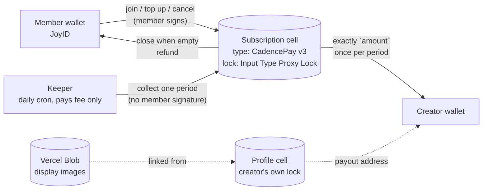
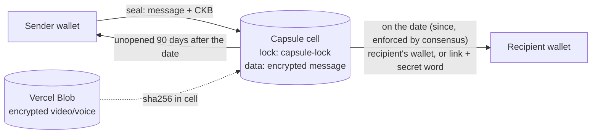

# CKBuilders — Linet Mugwanja

Progress log for the [CKBuilders program](https://nervoscatalyst.org/community-keeps-building) — Nervos Community Catalyst's structured 3-month developer cohort.

## Repository Structure

    ckbuilders/
    ├── reports/      # Weekly progress reports 
    ├── experiments/  # Code experiments from the CKB Academy and handbook
    └── notes/        # Concept notes and reading summaries

## Weekly Reports
| Week | Period | Status | Report |
|------|--------|--------|--------|
| W1 | Jul 28 – Aug 2 | ✅ Complete | [View →](./reports/ckb_weekly_report_w1.md) |
| W2 | Aug 3 – Aug 9 | ✅ Complete | [View →](./reports/ckb_weekly_report_w2.md) |
| W3 | Aug 10 – Aug 16 | ✅ Complete | [View →](./reports/ckb_weekly_report_w3.md) |
| W4 | Aug 17 – Aug 23 | ✅ Complete | [View →](./reports/ckb_weekly_report_w4.md) |
| W5 | Aug 24 – Aug 30 | ✅ Complete | [View →](./reports/ckb_weekly_report_w5.md) |
| W6 | Sep 1 – Sep 7 | ✅ Complete | [View →](./reports/ckb_weekly_report_w6.md) |
| W7 | Sep 8 – Sep 13 | ✅ Complete | [View →](./reports/ckb_weekly_report_w7.md) |
| W8 | Sep 14 – Sep 20 | ✅ Complete | [View →](./reports/ckb_weekly_report_w8.md) |
| W9 | Sep 22 – Sep 27 | ✅ Complete | [View →](./reports/ckb_weekly_report_w9.md) |
| W10 | Sep 28 – Oct 4 | ✅ Complete | [View →](./reports/ckb_weekly_report_w10.md) |
| W11 | Oct 5 – Oct 11 | ✅ Complete | [View →](./reports/ckb_weekly_report_w11.md) |
| W12 | Oct 12 – Oct 19 | ✅ Complete | [View →](./reports/ckb_weekly_report_w12.md) |

## Projects

### CadencePay: recurring payments where the payer keeps control
Live: [cadencepay-demo.vercel.app](https://cadencepay-demo.vercel.app) · Docs: [/docs](https://cadencepay-demo.vercel.app/docs) · npm: [`cadencepay`](https://www.npmjs.com/package/cadencepay)

A member funds their **own** subscription cell. The creator (or anyone) can collect at most the agreed amount once per period, always paid to the creator. The member can top up or cancel at any time. One type script enforces it all; no server holds keys or money.

| Package | What | Tests |
|---|---|---|
| [`experiments/time-lock-script/contracts/cadencepay`](./experiments/time-lock-script/contracts/cadencepay) | Rust type script (v3, testnet `0x7c271b62…0419`) | 46 attack tests, `cargo test -p tests cadencepay_v3` |
| [`experiments/cadencepay-sdk`](./experiments/cadencepay-sdk) | `cadencepay` on npm: unsigned tx builders, chain reads | 19, `npm test` |
| [`experiments/cadencepay-demo`](./experiments/cadencepay-demo) | Next.js landing, docs and Patreon-style demo | `npm run build && npm run lint` |

### Message in a Cell: a message and CKB, sealed until a day that matters
Sister project to Sats in a Bottle. A letter, photo, video or voice note is sealed in a cell with CKB. On the day, opening it reveals the message and releases all the CKB, including the CKB that stored the message.

| Package | What | Tests |
|---|---|---|
| [`experiments/time-lock-script/contracts/capsule-lock`](./experiments/time-lock-script/contracts/capsule-lock) | Rust lock: gift and legacy modes (testnet `0x23d62274…67be`) | 23 attack tests, `cargo test -p tests capsule_lock` |
| [`experiments/message-in-a-cell`](./experiments/message-in-a-cell) | Next.js app: seal, open, my capsules | 6 unit tests plus a live testnet e2e |

Testnet deployments and verified transactions: [`notes/deployments.md`](./notes/deployments.md). Security notes: [`notes/cadencepay-threat-model.md`](./notes/cadencepay-threat-model.md).

## Program Resources

- [Official CKB Docs](https://docs.nervos.org)
- [CKB Academy](https://academy.ckb.dev)
- [Nervos Talk Forum](https://talk.nervos.org)
